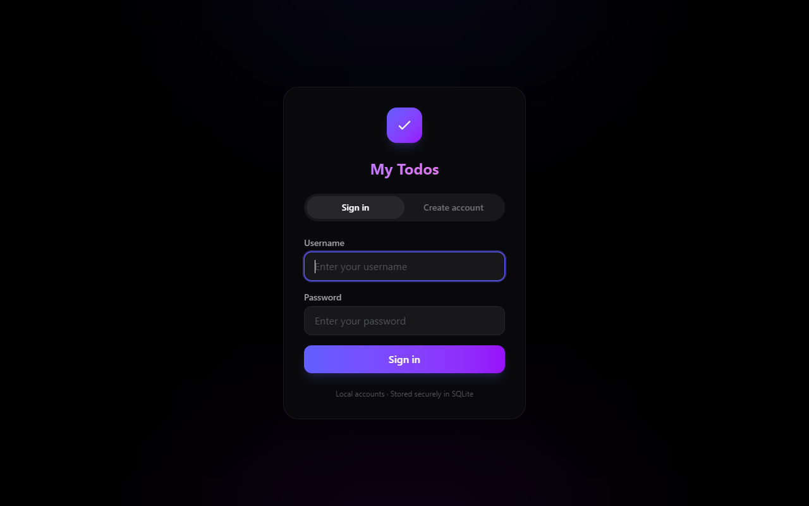
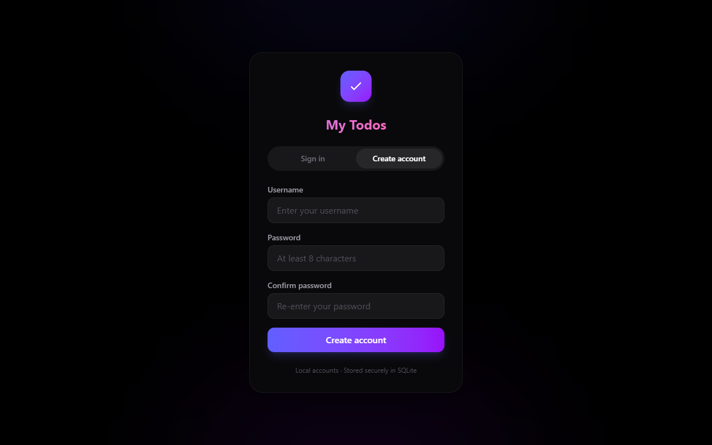
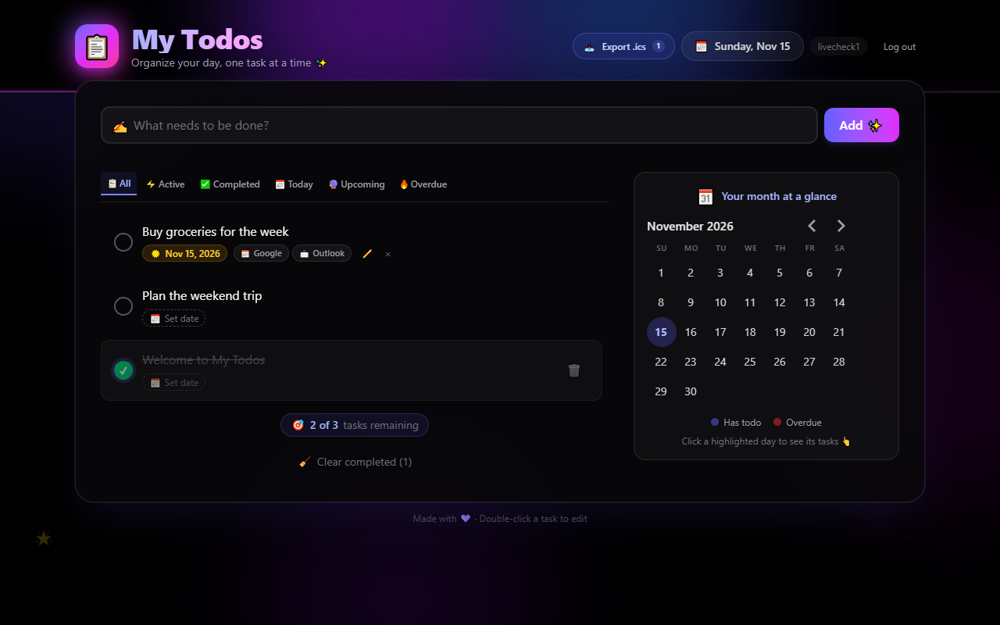
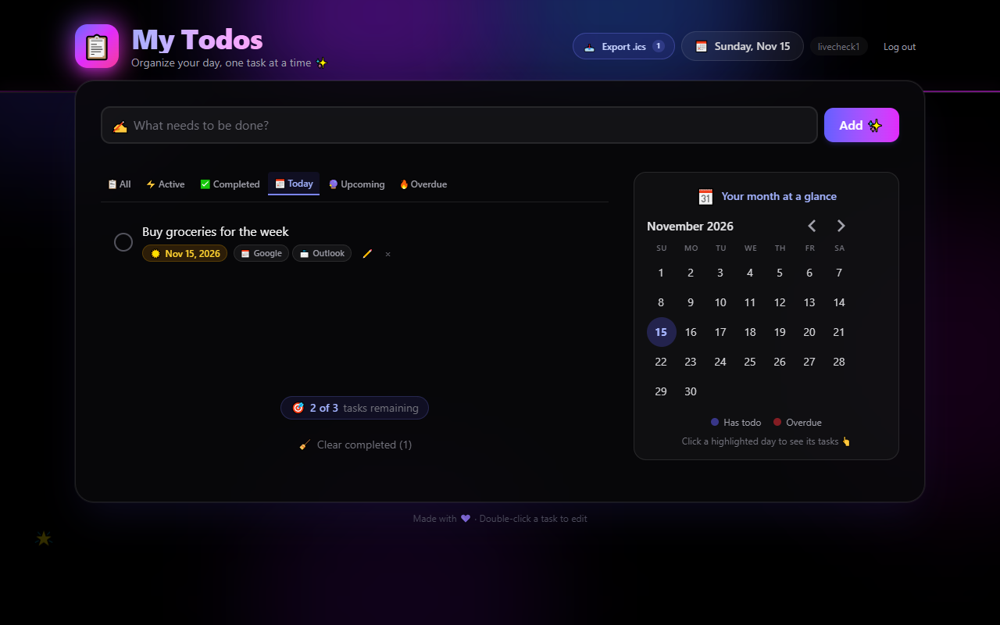
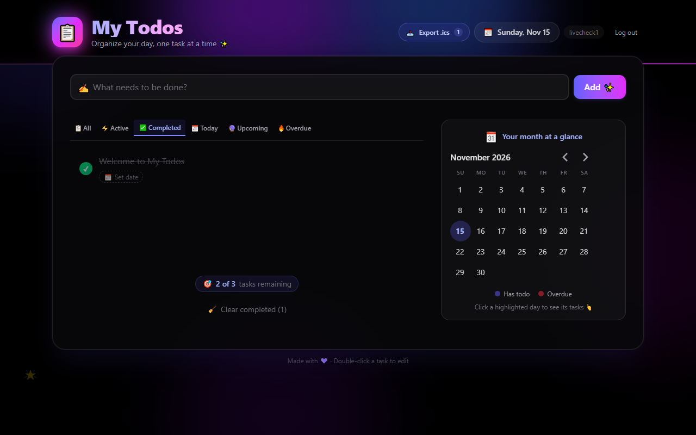

# My Todos

A multi-user todo app with a React front end and an Express + SQLite backend.
Each account has its own private todo list; sessions are stored server-side and
referenced by an HTTP-only cookie.



## Screenshots

| | |
|---|---|
|  |  |
|  |  |

## User guide

1. **Create an account** — open the app and switch to *Create account*. Pick a
   username (3+ characters) and a password (8+ characters). Passwords are stored
   as salted scrypt hashes; there is no pre-defined default user.
2. **Add a task** — type into "What needs to be done?" and click **Add** (or
   press Enter).
3. **Edit a task** — double-click its text, edit, then press Enter.
4. **Complete a task** — click the circle checkbox next to it.
5. **Set a due date** — click *Set date* on a task, then pick a day in the
   popover (or press **Today**).
6. **Filter** — use *Active*, *Completed*, *Today*, *Upcoming*, or *Overdue* to
   focus the list.
7. **Export your schedule** — *Export .ics* downloads all dated tasks as a
   calendar file; each dated task also has one-click **Google / Outlook**
   calendar links.
8. **See your month** — the calendar panel highlights days that have tasks
   (blue) or overdue tasks (red). Click a highlighted day to see its tasks.
9. **Log out** — your session cookie is cleared; your tasks stay in your
   account.

## Requirements

- Node.js 26 or newer (the server runs TypeScript directly and uses the built-in
  `node:sqlite` driver)

## Getting started

```powershell
npm install
npm run dev
```

- Web app: <http://localhost:5173>
- API: <http://localhost:3001> (the dev client calls it directly — no Vite proxy)

Create your own account from the login page — there is no pre-defined default
user.

## Data

Accounts, sessions, and todos live in `data/todos.db` (SQLite). The file and its
directory are created on first start and are ignored by git. Delete the file to
reset the app; it starts empty, so register a new account on next start.

Passwords are stored as salted scrypt hashes, and session tokens are stored only
as SHA-256 hashes. Todos left in the old browser `localStorage` list are imported
once into the first account you sign in with in that browser.

## Scripts

| Command | What it does |
|---|---|
| `npm run dev` | Runs the API with watch mode and the Vite dev server together |
| `npm run dev:server` | Runs only the API (`node --watch server/index.ts`) |
| `npm run dev:client` | Runs only the Vite dev server |
| `npm run build` | Type-checks the app and server, then builds `dist/` |
| `npm start` | Runs the API and serves the built app from `dist/` |
| `npm test` | Runs the Vitest suite in watch mode |
| `npm run test:run` | Runs the Vitest suite once |
| `npm run lint` | Runs Oxlint |

## Production

```powershell
npm run build
npm start
```

Express serves the API and the built front end from one server (port 80 by
default). Set `PORT` to change the port. When serving over HTTPS, set
`COOKIE_SECURE=true` so session cookies are marked `Secure`.

Environment variables:

| Variable | Default | Purpose |
|---|---|---|
| `PORT` | `80` | HTTP port |
| `DB_PATH` | `data/todos.db` | SQLite database location |
| `COOKIE_SECURE` | unset | Set to `true` behind HTTPS |
